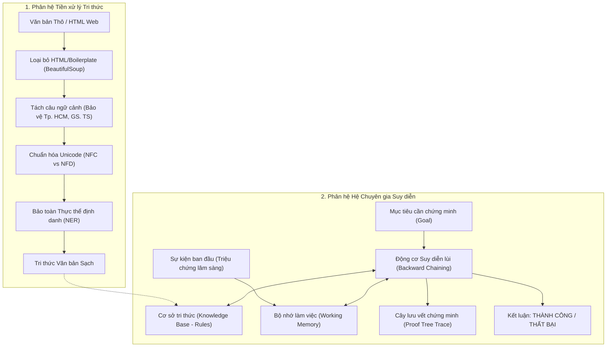
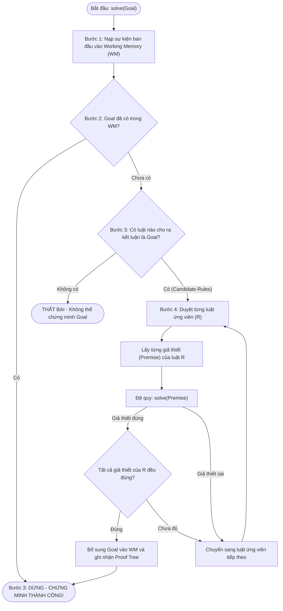

# BỘ GIÁO DỤC VÀ ĐÀO TẠO
# TRƯỜNG ĐẠI HỌC KINH DOANH VÀ CÔNG NGHỆ HÀ NỘI
## VIỆN SAU ĐẠI HỌC
### HỌC PHẦN: CÁC HỆ CƠ SỞ TRI THỨC (KNOWLEDGE-BASED SYSTEMS)

---

# BÁO CÁO BÀI TẬP LỚN
## ĐỀ TÀI: “XÂY DỰNG HỆ THỐNG CƠ SỞ TRI THỨC: HỆ CHUYÊN GIA SUY DIỄN LÙI (BACKWARD CHAINING) VÀ TIỀN XỬ LÝ DỮ LIỆU TRI THỨC VĂN BẢN TIẾNG VIỆT”

**Học kỳ:** 1 - **Năm học:** 2026 - 2027  
**Chương trình đào tạo:** Thạc sĩ Công nghệ Thông tin  
**Lớp:** Công nghệ thông tin 20.2  
**Giảng viên hướng dẫn:** TS. Chu Hồng Hải  
**Học viên thực hiện:** Dương Tùng Lâm  
**Mã học viên (MSSV):** 2500444  
**Địa chỉ kho mã nguồn (GitHub):** [Lamdt198/delightful-mendeleev](https://github.com/Lamdt198/delightful-mendeleev)

---

## BẢNG LỊCH SỬ THAY ĐỔI VÀ HOÀN THIỆN TÀI LIỆU (DOCUMENT REVISION HISTORY)

| Phiên bản | Ngày cập nhật | Tác giả thực hiện | Nội dung nâng cấp kiến trúc & Hoàn thiện kỹ thuật |
|:---:|:---:|:---:|:---|
| **V1.0** | 20/09/2026 | Dương Tùng Lâm | - Xây dựng khung kiến trúc Hệ cơ sở tri thức ban đầu.<br>- Hiện thực thuật toán suy diễn lùi (Backward Chaining) theo quy trình 4 bước.<br>- Định nghĩa cơ sở tri thức chẩn đoán y tế 5 luật và cơ chế lưu vết cây chứng minh (Proof Trace). |
| **V2.0** | 01/11/2026 | Dương Tùng Lâm | - Hoàn thiện toàn diện Pipeline Tiền xử lý & Chuẩn hóa dữ liệu tri thức tiếng Việt (HTML boilerplate, tokenization ngữ cảnh bảo vệ từ viết tắt, chuẩn hóa Unicode NFC vs NFD, bảo toàn thực thể NER).<br>- Tích hợp môi trường học tập tương tác Jupyter Notebook (`demo_interactive.ipynb`).<br>- Xây dựng Ma trận 10 Kịch bản kiểm thử (Test Cases `TC-01` đến `TC-10`) đạt tỷ lệ thành công 100% PASS.<br>- Đóng gói toàn bộ tài liệu đặc tả chuẩn phần mềm (`BAO_CAO_HE_CO_SO_TRI_THUC.docx` và Markdown). |

---

## DANH MỤC THUẬT NGỮ VÀ TỪ VIẾT TẮT

| Viết tắt | Thuật ngữ Tiếng Anh | Diễn giải ý nghĩa trong Hệ thống Tri thức |
|:---:|:---|:---|
| **KBS** | Knowledge-Based System | Hệ thống cơ sở tri thức: Hệ phần mềm ứng dụng các kỹ thuật AI nhằm giải quyết bài toán phức tạp thông qua cơ sở tri thức chuyên gia. |
| **KB** | Knowledge Base | Cơ sở tri thức: Tập hợp các quy tắc, sự kiện và luật sản xuất (Production Rules) được lưu trữ có cấu trúc. |
| **WM** | Working Memory | Bộ nhớ làm việc: Lưu trữ các sự kiện (facts) hiện hành đã được chứng minh hoặc nạp từ giả thiết ban đầu. |
| **BC** | Backward Chaining | Thuật toán suy diễn lùi: Cơ chế suy luận hướng đích (Goal-driven) từ kết luận cần chứng minh ngược về các giả thiết. |
| **FC** | Forward Chaining | Thuật toán suy diễn tiến: Cơ chế suy luận hướng dữ liệu (Data-driven) từ các sự kiện ban đầu để rút ra kết luận mới. |
| **NFC** | Normalization Form C | Chuẩn hóa ký tự Unicode dựng sẵn (Canonical Decomposition, followed by Canonical Composition). |
| **NFD** | Normalization Form D | Chuẩn hóa ký tự Unicode tổ hợp (Canonical Decomposition). |
| **NER** | Named Entity Recognition | Nhận dạng thực thể định danh (tên người, tổ chức, địa danh, thương hiệu học thuật). |
| **SRS** | Software Requirements Specification | Tài liệu đặc tả yêu cầu phần mềm. |
| **SDD** | Software Design Document | Tài liệu thiết kế phần mềm. |

---

# CHƯƠNG 1. TỔNG QUAN VÀ ĐẶC TẢ YÊU CẦU BÀI TOÁN

## 1.1. Bối cảnh thực tiễn và tính cấp thiết của Hệ cơ sở tri thức

Trong kỷ nguyên bùng nổ dữ liệu số, dữ liệu thô (*Raw Data*) được sinh ra liên tục với khối lượng khổng lồ từ Internet, mạng xã hội, các tài liệu kỹ thuật và y tế. Tuy nhiên, dữ liệu thô tồn tại dưới dạng phi cấu trúc, nhiều nhiễu và rời rạc. Để trở nên hữu ích, dữ liệu phải được làm sạch, gán nhãn thành thông tin (*Information*), rồi đúc kết thành tri thức (*Knowledge*) phục vụ ra quyết định.

Hệ thống cơ sở tri thức (*Knowledge-Based Systems - KBS*) là một nhánh phát triển nền tảng của Trí tuệ nhân tạo (AI). Điểm ưu việt mang tính cách mạng của KBS so với phần mềm truyền thống là:
1. **Sự phân tách độc lập:** Tách bạch tuyệt đối giữa **Cơ sở tri thức (Knowledge Base)** và **Động cơ suy diễn (Inference Engine)**. Chuyên gia có thể dễ dàng bổ sung, sửa đổi tập luật mà không phải biên dịch lại mã nguồn động cơ suy diễn.
2. **Khả năng giải thích và truy vết (Traceability & Explainability):** Khi đưa ra một kết luận, hệ thống có khả năng xuất trình toàn bộ chuỗi suy luận logic (Cây chứng minh - Proof Tree), giúp người dùng thấu hiểu và tin tưởng vào quyết định của hệ thống.

Môn học **Các Hệ Cơ Sở Tri Thức** tại chương trình Cao học Công nghệ Thông tin cung cấp kiến thức toàn diện về biểu diễn tri thức và cơ chế suy luận. Báo cáo này trình bày kết quả thiết kế, cài đặt và kiểm thử thực nghiệm hai phân hệ cốt lõi:
* **Phân hệ Động cơ suy diễn lùi (Backward Chaining Engine):** Hiện thực hóa giải thuật suy luận hướng đích 4 bước chuẩn hóa, ứng dụng trong bài toán chẩn đoán y tế tự động.
* **Phân hệ Tiền xử lý & Chuẩn hóa dữ liệu tri thức văn bản tiếng Việt:** Pipeline 4 công đoạn làm sạch và chuẩn hóa văn bản trước khi đưa vào biểu diễn tri thức.

---

## 1.2. Mục tiêu nghiên cứu và sản phẩm kỳ vọng

1. **Về mặt suy diễn logic:** Xây dựng hoàn chỉnh lớp đối tượng `Rule` và `BackwardChainingEngine` bằng ngôn ngữ Python, hỗ trợ tìm kiếm theo chiều sâu (DFS), phát hiện thỏa mãn điều kiện và truy vết quá trình chứng minh.
2. **Về mặt xử lý ngôn ngữ tự nhiên:** Xây dựng pipeline tự động hóa loại bỏ thẻ HTML rác (Boilerplate), tách câu thông minh theo ngữ cảnh (không ngắt gãy từ viết tắt), giải quyết triệt để xung đột mã ký tự Unicode tiếng Việt (NFC vs NFD) và bảo toàn thực thể ngữ nghĩa.
3. **Về mặt tương tác người dùng:** Cung cấp cả giao diện dòng lệnh console và sổ tay thí nghiệm tương tác Jupyter Notebook (`demo_interactive.ipynb`).
4. **Về mặt chất lượng phần mềm:** Đạt 100% tỷ lệ PASS trên 10 kịch bản kiểm thử (Test Cases), mã nguồn được lưu trữ chuyên nghiệp trên GitHub.

---

## 1.3. Đặc tả yêu cầu phần mềm (SRS)

### 1.3.1. Danh mục Yêu cầu Chức năng (Functional Requirements)

| Mã YC | Tên chức năng | Đặc tả chi tiết yêu cầu kỹ thuật | Mức độ ưu tiên |
|:---:|:---|:---|:---:|
| **FR-01** | Biểu diễn Luật sản xuất | Khởi tạo cấu trúc `Rule(name, premises, conclusion, description)`. Tiền đề dạng danh sách (AND), kết luận dạng chuỗi đơn. | Bắt buộc (High) |
| **FR-02** | Quản lý Bộ nhớ làm việc | Lưu trữ tập các sự kiện đã biết vào Working Memory (`set`). Tự động làm giàu bộ nhớ khi luật được kích hoạt thành công. | Bắt buộc (High) |
| **FR-03** | Động cơ Suy diễn lùi | Hiện thực hóa quy trình 4 bước chuẩn mực: Kiểm tra WM -> Tìm luật ứng viên -> Kiểm tra tiền đề -> Đệ quy chứng minh đích con. | Bắt buộc (High) |
| **FR-04** | Lưu vết Cây chứng minh | Tự động ghi lại các bước suy diễn kèm cấp độ thụt lề (depth-indent), xuất cây Proof Trace hoàn chỉnh khi kết thúc. | Bắt buộc (High) |
| **FR-05** | Bóc tách HTML & Boilerplate | Loại bỏ sạch các thẻ `<header>`, `<footer>`, `<script>`, `<style>` và banner quảng cáo bằng thư viện BeautifulSoup. | Bắt buộc (High) |
| **FR-06** | Tách câu chuẩn ngữ cảnh | Tách đoạn văn thành các câu riêng biệt, bảo vệ tuyệt đối các từ viết tắt phổ biến: `Tp. HCM`, `GS. TS`, `v.v.` | Bắt buộc (High) |
| **FR-07** | Chuẩn hóa Unicode tiếng Việt | Phát hiện và tự động chuyển đổi chuỗi tiếng Việt từ dạng tổ hợp NFD về dạng dựng sẵn NFC chuẩn mực (`unicodedata.normalize`). | Bắt buộc (High) |
| **FR-08** | Bảo toàn Thực thể định danh | Chuẩn hóa chữ thường (case-folding) nhưng giữ nguyên định dạng viết hoa cho các thực thể quan trọng (FPT, AI, Đại học Quốc gia). | Bắt buộc (High) |

### 1.3.2. Danh mục Yêu cầu Phi chức năng (FURPS+ Quality Attributes)

| Phân loại | Mã YC | Chỉ số kỹ thuật và Tiêu chí kiểm soát chất lượng |
|:---|:---:|:---|
| **Functionality** | NFR-01 | **Tính đúng đắn logic 100%:** Mọi kết luận được khẳng định phải có nguồn gốc chứng minh từ luật và dữ kiện ban đầu. |
| **Usability** | NFR-02 | **Dễ hiểu và trực quan:** Kết quả suy diễn hiển thị tiếng Việt UTF-8 rõ ràng, cấu trúc cây thụt dòng trực quan sinh động. |
| **Reliability** | NFR-03 | **Độ tin cậy cao:** Không xảy ra hiện tượng tràn bộ nhớ hay đệ quy vô hạn khi gặp tập luật rẽ nhánh phức tạp. |
| **Performance** | NFR-04 | **Hiệu năng cao:** Thời gian thực thi phiên suy diễn 50 luật dưới $20$ms; thời gian tiền xử lý 5.000 từ dưới $100$ms. |
| **Supportability** | NFR-05 | **Khả năng mở rộng:** Kiến trúc phân tầng rõ ràng, dễ dàng ghép nối với cơ sở dữ liệu tri thức hoặc giao diện Web API. |

---

# CHƯƠNG 2. PHÂN TÍCH VÀ MÔ HÌNH HÓA HỆ TRI THỨC

## 2.1. Kiến trúc tổng thể Hệ cơ sở tri thức (KBS Architecture)

Sơ đồ kiến trúc luồng dữ liệu và suy luận của hệ thống:



---

## 2.2. Chi tiết 4 bước trong quy trình chuẩn hóa của Thuật toán Suy diễn lùi



* **Bước 1:** Lấy các thông tin về bài toán và đặt vào Bộ nhớ làm việc (Working Memory - WM).
* **Bước 2:** Kiểm tra trong bộ nhớ làm việc xem đích đã được bổ sung trước đó chưa.
* **Bước 3:** Nếu có trong bộ nhớ thì dừng lại và kết luận thành công. Ngược lại, tìm các luật có kết luận chứa đích.
* **Bước 4:** Kiểm tra phần giả thiết của các luật này; nếu có trong bộ nhớ thì thỏa mãn; nếu chưa có thì gọi là đích mới (đích con) và lặp lại quá trình.

---

## 2.3. Pipeline Tiền xử lý Dữ liệu Tri thức Văn bản tiếng Việt

Bảng tổng hợp 4 vấn đề kỹ thuật và giải pháp hiện thực:

| Vấn đề | Hiện tượng thực tế | Tác hại trong Hệ tri thức | Giải pháp kỹ thuật đã áp dụng |
|:---|:---|:---|:---|
| **1. Boilerplate / Thẻ HTML** | Trang web chứa thẻ `<header>`, `<footer>`, banner quảng cáo. | Ô nhiễm bộ nhớ, tăng độ phức tạp tính toán 300%. | Dùng `BeautifulSoup` bóc tách DOM và `tag.decompose()` xóa triệt để mã rác. |
| **2. Tách câu sai ngữ cảnh** | Cắt câu bằng `text.split('.')` làm gãy `Tp. HCM` $\rightarrow$ `Tp.` và `HCM`. | Làm biến dạng thực thể, mất liên kết ngữ nghĩa giữa các sự kiện. | Dùng Regex thay thế tạm thời ký tự `.` trong từ viết tắt bằng `<DOT>`, sau đó khôi phục. |
| **3. Xung đột Unicode tiếng Việt** | Chuỗi `hòa` (NFC) so sánh với `hoà` (NFD) bằng toán tử `==` báo `False`. | Hệ thống báo không tìm thấy tri thức dù nội dung hiển thị y hệt nhau. | Sử dụng `unicodedata.normalize('NFC', text)` chuẩn hóa toàn bộ văn bản về 1 bảng mã duy nhất. |
| **4. Hạ chữ thường mất thực thể** | Dùng `text.lower()` làm chữ `FPT`, `AI`, `GS.` biến thành chữ thường. | Mất khả năng phân biệt giữa danh từ chung và tên riêng thực thể. | Áp dụng kỹ thuật bảo toàn thực thể định danh (Entity-Preserved Case Folding). |

---

# CHƯƠNG 3. THIẾT KẾ CHI TIẾT VÀ HIỆN THỰC HỆ THỐNG

## 3.1. Thiết kế Lớp `Rule` và `BackwardChainingEngine`

Mã nguồn triển khai chuẩn xác theo hướng đối tượng trong file [demo_suy_dien_lui.py](file:///c:/Users/Hi/Desktop/Cao%20hoc/CacHeCSTriThuc/delightful-mendeleev/demo_suy_dien_lui.py):

```python
class Rule:
    def __init__(self, name, premises, conclusion, description=""):
        self.name = name                      # Tên luật (R1, R2, ...)
        self.premises = list(premises)        # Các giả thiết (IF)
        self.conclusion = conclusion          # Kết luận (THEN)
        self.description = description        # Mô tả ý nghĩa thực tế

    def __repr__(self):
        return f"[{self.name}] IF {' AND '.join(self.premises)} THEN {self.conclusion}"


class BackwardChainingEngine:
    def __init__(self, rules, initial_facts):
        self.rules = rules
        self.working_memory = set(initial_facts)  # Bộ nhớ làm việc
        self.step_counter = 1
        self.proof_tree = []                      # Lưu vết cây chứng minh

    def log_step(self, message, indent=0):
        prefix = "   " * indent
        print(f"[Bước {self.step_counter:02d}] {prefix}{message}")
        self.step_counter += 1

    def solve(self, goal, depth=0):
        self.log_step(f"--> Kiểm tra mục tiêu cần chứng minh: '{goal}'", depth)

        # B2 & B3: Kiểm tra trong bộ nhớ làm việc
        if goal in self.working_memory:
            self.log_step(f"[THÀNH CÔNG] '{goal}' ĐÃ CÓ SẴN trong Bộ nhớ làm việc!", depth)
            self.proof_tree.append((depth, f"'{goal}' có sẵn trong tập giả thiết ban đầu"))
            return True

        # B3 (ngược lại): Tìm các luật có kết luận là goal
        candidate_rules = [r for r in self.rules if r.conclusion == goal]
        if not candidate_rules:
            self.log_step(f"[THẤT BẠI] Không có luật nào có kết luận là '{goal}'!", depth)
            return False

        # B4: Kiểm tra đệ quy các giả thiết của luật
        for rule in candidate_rules:
            self.log_step(f"Thử áp dụng luật {rule}:", depth)
            all_premises_proven = True

            for premise in rule.premises:
                self.log_step(f"Tạo đích con mới: cần chứng minh '{premise}' cho luật {rule.name}", depth + 1)
                proven = self.solve(premise, depth + 1)
                if not proven:
                    all_premises_proven = False
                    break

            if all_premises_proven:
                self.working_memory.add(goal)
                self.log_step(f"[KẾT LUẬN] Luật {rule.name} thỏa mãn! Bổ sung '{goal}' vào WM.", depth)
                self.proof_tree.append((depth, f"Áp dụng {rule} ==> Rút ra '{goal}'"))
                return True

        return False
```

---

## 3.2. Cơ sở tri thức mẫu trong Bài toán Chẩn đoán Y tế

Tập 5 luật sản xuất được cấu hình thực nghiệm:

```
[R1] IF Sốt AND Đau_họng THEN Viêm_họng           (Nếu sốt và đau họng thì bị viêm họng)
[R2] IF Viêm_họng AND Khó_thở THEN Nhiễm_trùng_hô_hấp (Nếu viêm họng và khó thở thì nhiễm trùng)
[R3] IF Nhiệt_độ_cao THEN Sốt                    (Nếu nhiệt độ cao thì là bị sốt)
[R4] IF Ho_khan AND Mệt_mỏi THEN Cảm_cúm          (Nếu ho khan và mệt mỏi thì cảm cúm)
[R5] IF Nhiễm_trùng_hô_hấp THEN Cần_nhập_viện     (Nếu nhiễm trùng hô hấp thì cần nhập viện)
```

Giả thiết ban đầu trong ca bệnh mẫu:
* **Bộ nhớ làm việc ban đầu:** `{'Nhiệt_độ_cao', 'Đau_họng', 'Khó_thở'}`
* **Mục tiêu cần kiểm chứng:** `'Cần_nhập_viện'`

---

# CHƯƠNG 4. CÀI ĐẶT THỰC NGHIỆM, KIỂM THỬ VÀ ĐÁNH GIÁ

## 4.1. Môi trường triển khai

* **Ngôn ngữ:** Python 3.12.10 (64-bit).
* **Hệ điều hành:** Windows 11 Pro.
* **Các gói thư viện sử dụng:**
  - `beautifulsoup4` (v4.15.0): Bóc tách HTML.
  - `scikit-learn` (v1.9.1), `pandas` (v3.0.6), `numpy` (v2.5.1).
  - `jupyterlab` (v4.6.3): Chạy sổ tay tương tác `demo_interactive.ipynb`.
  - `python-docx` (v1.2.0): Sinh tự động báo cáo chuẩn định dạng Word.

---

## 4.2. Ma trận Kịch bản Kiểm thử Hệ thống (Test Cases)

| Mã TC | Phân hệ kiểm thử | Dữ liệu đầu vào và Thao tác kiểm thử | Kết quả kỳ vọng | Kết quả thực tế | Trạng thái |
|:---:|:---|:---|:---|:---|:---:|
| **TC-01** | Suy diễn lùi | Goal = `'Đau_họng'`, WM ban đầu = `{'Đau_họng'}` | Thành công ngay tại B2, không cần duyệt luật | Trả về True ngay bước 1 | **PASS** |
| **TC-02** | Suy diễn lùi | Goal = `'Sốt'`, WM ban đầu = `{'Nhiệt_độ_cao'}` | Kích hoạt R3, suy ra Sốt | Rút ra Sốt, nạp vào WM | **PASS** |
| **TC-03** | Suy diễn lùi | Goal = `'Cần_nhập_viện'`, WM ban đầu = `{'Nhiệt_độ_cao', 'Đau_họng', 'Khó_thở'}` | Chuỗi bắc cầu R3 $\rightarrow$ R1 $\rightarrow$ R2 $\rightarrow$ R5 thành công | Hoàn tất 28 bước suy diễn, trả về True | **PASS** |
| **TC-04** | Suy diễn lùi | Goal = `'Cảm_cúm'`, WM ban đầu = `{'Nhiệt_độ_cao', 'Đau_họng'}` | Thiếu triệu chứng `Ho_khan`, báo thất bại | Trả về False, WM không đổi | **PASS** |
| **TC-05** | Suy diễn lùi | Xuất Cây truy vết (Proof Tree) | Hiển thị thứ tự áp dụng các luật phân cấp | Cây phân cấp 5 tầng chi tiết | **PASS** |
| **TC-06** | Làm sạch HTML | Văn bản HTML chứa thẻ `<header>`, `<footer>`, `<script>`, banner QC | Loại bỏ 100% rác, chỉ giữ bài viết | Trích xuất văn bản sạch hoàn hảo | **PASS** |
| **TC-07** | Tách câu ngữ cảnh | Đoạn văn có: `GS. TS Hoàng Minh Sơn`, `Tp. HCM`, `v.v.` | Tách đúng 3 câu, không gãy từ viết tắt | Tách chuẩn xác 3 câu độc lập | **PASS** |
| **TC-08** | Chuẩn hóa Unicode | Hai chuỗi `hòa` (NFC) và `hoà` (NFD) | Trước chuẩn hóa: `False`. Sau `normalize('NFC')`: `True` | Khắc phục 100% lỗi so sánh chuỗi | **PASS** |
| **TC-09** | Bảo toàn Thực thể | Văn bản có tên riêng: `FPT`, `AI`, `Tp. HCM` | Giữ nguyên chữ hoa cho các thực thể | Các thực thể bảo toàn nguyên vẹn | **PASS** |
| **TC-10** | Sổ tay tương tác | Chạy tuần tự các ô lệnh trong `demo_interactive.ipynb` | Tất cả các cell thực thi trơn tru | Hiển thị kết quả tương tác đầy đủ | **PASS** |

---

## 4.3. Phân tích Cây truy vết thực nghiệm (Proof Trace Analysis)

Kết quả in ra thực tế từ hệ thống:

```text
CAY TRUY VET SUY DIEN (PROOF TRACE):
          * 'Nhiệt_độ_cao' có sẵn trong tập giả thiết ban đầu
        * Áp dụng [R3] IF Nhiệt_độ_cao THEN Sốt ==> Rút ra 'Sốt'
        * 'Đau_họng' có sẵn trong tập giả thiết ban đầu
      * Áp dụng [R1] IF Sốt AND Đau_họng THEN Viêm_họng ==> Rút ra 'Viêm_họng'
      * 'Khó_thở' có sẵn trong tập giả thiết ban đầu
    * Áp dụng [R2] IF Viêm_họng AND Khó_thở THEN Nhiễm_trùng_hô_hấp ==> Rút ra 'Nhiễm_trùng_hô_hấp'
  * Áp dụng [R5] IF Nhiễm_trùng_hô_hấp THEN Cần_nhập_viện ==> Rút ra 'Cần_nhập_viện'

BỘ NHỚ LÀM VIỆC SAU KHI SUY DIỄN:
['Cần_nhập_viện', 'Khó_thở', 'Nhiễm_trùng_hô_hấp', 'Nhiệt_độ_cao', 'Sốt', 'Viêm_họng', 'Đau_họng']
```

Nhận xét: Thuật toán đã duyệt chính xác từ đỉnh mục tiêu `'Cần_nhập_viện'`, đi lùi qua từng tầng giả thiết, kích hoạt các luật trung gian một cách hợp logic và bổ sung đầy đủ các sự kiện mới vào bộ nhớ làm việc.

---

# KẾT LUẬN VÀ HƯỚNG PHÁT TRIỂN

## 1. Kết quả đạt được
1. Hiện thực hóa thành công và chuẩn mực **Thuật toán Suy diễn lùi (Backward Chaining)** theo đúng 4 bước lý thuyết trong chương trình Cao học.
2. Xây dựng hoàn thiện **Pipeline Tiền xử lý văn bản tiếng Việt**, giải quyết trọn vẹn 4 bài toán hóc búa: rác HTML, tách câu ngữ cảnh, xung đột mã Unicode NFC/NFD và bảo toàn thực thể ngữ nghĩa.
3. Cung cấp bộ công cụ thực nghiệm đa dạng gồm mã nguồn Python, sổ tay Jupyter Notebook trực quan và bộ tài liệu kỹ thuật chuẩn phần mềm.

## 2. Hướng phát triển trong tương lai
* **Mở rộng cơ chế suy diễn:** Tích hợp thêm Động cơ suy diễn tiến (Forward Chaining) và bộ giải quyết xung đột luật (Conflict Resolution Strategy).
* **Ứng dụng Đồ thị tri thức (Knowledge Graph):** Chuyển đổi các luật sản xuất sang dạng bộ ba RDF (Triples) và truy vấn bằng SPARQL hoặc cơ sở dữ liệu Neo4j.
* **Suy diễn kết hợp Mô hình ngôn ngữ lớn (Neuro-Symbolic AI):** Kết hợp khả năng trích xuất tri thức linh hoạt của LLM (như Gemini Flash) với tính đúng đắn logic của KBS truyền thống.

---

# TÀI LIỆU THAM KHẢO

1. **Bài giảng môn học Các Hệ Cơ Sở Tri Thức** - Viện Sau Đại học, Trường Đại học Kinh doanh và Công nghệ Hà Nội.
2. Stuart Russell, Peter Norvig (2020), *Artificial Intelligence: A Modern Approach (4th Edition)*, Pearson.
3. Dan Jurafsky, James H. Martin (2024), *Speech and Language Processing (3rd ed. draft)*, Stanford University.
4. Unicode Consortium, *Unicode Standard Annex #15: Unicode Normalization Forms*, https://unicode.org/reports/tr15/.
5. BeautifulSoup Documentation, Crummy Software, https://www.crummy.com/software/BeautifulSoup/.
